# BC WareHouse — ดิจิทัลทวินคลังวัสดุก่อสร้าง 3 มิติ (เดโมต้นแบบ)

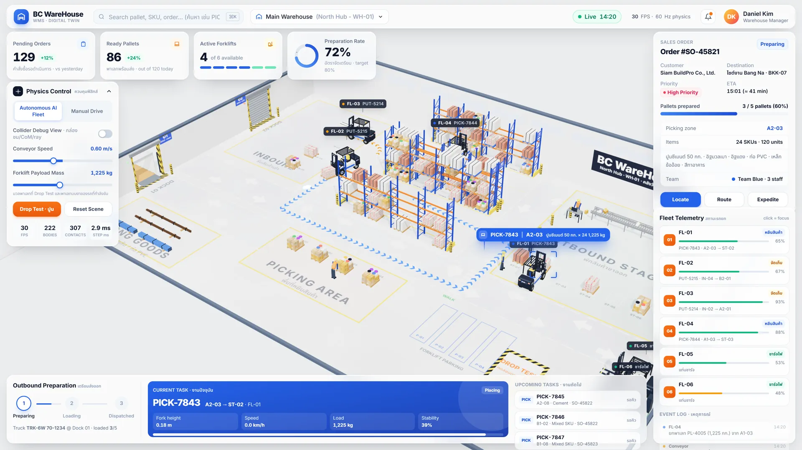

**BC WareHouse** คือเดโมต้นแบบของ “แฝดดิจิทัล” (Digital Twin) ของคลังวัสดุก่อสร้าง ที่แสดงคลังทั้งหลังเป็นภาพ 3 มิติแบบเรียลไทม์บนเว็บเบราว์เซอร์
มีรถยก 6 คันที่ขับเองด้วย AI ชั้นวางพาเลท สายพานลำเลียง รถบรรทุกที่ท่าขาออก และพนักงานในคลัง ทุกอย่างเคลื่อนที่ด้วย **ฟิสิกส์จริง** (cannon-es 60 Hz) ไม่ใช่แอนิเมชันที่ทำไว้ล่วงหน้า

- 🔗 **ทดลองใช้งานออนไลน์:** <https://test01.bcsmethai.com>
- 🏢 **พัฒนาโดย:** บริษัท บ้านเชียงซอฟท์ จำกัด

> [!IMPORTANT]
> นี่คือ **เดโมต้นแบบ** เพื่อให้เห็นภาพก่อนพัฒนาระบบจริง ข้อมูลทั้งหมด (ออร์เดอร์ ลูกค้า KPI สต็อก) เป็น **ข้อมูลจำลอง**
> ส่วนการเชื่อมต่อ ERP, แท็กระบุตำแหน่ง (RTLS), บาร์โค้ด/RFID และการแจ้งเตือนผ่าน LINE เป็น **แนวคิดสำหรับระบบจริง** ยังไม่มีอยู่ในเดโมนี้ (ดูหัวข้อ [แนวทางสู่ระบบจริง](#9-แนวทางสู่ระบบจริง-แนวคิด--ยังไม่มีในเดโม))

---

## สารบัญ

1. [วัตถุประสงค์](#1-วัตถุประสงค์)
2. [ภาพรวมหน้าจอ](#2-ภาพรวมหน้าจอ)
3. [คลังสินค้า 3 มิติ (ดิจิทัลทวิน)](#3-คลังสินค้า-3-มิติ-ดิจิทัลทวิน)
4. [รถยก AI และระบบจ่ายงาน (WMS)](#4-รถยก-ai-และระบบจ่ายงาน-wms)
5. [แดชบอร์ดและแผงข้อมูล](#5-แดชบอร์ดและแผงข้อมูล)
6. [ทดลองด้วยฟิสิกส์](#6-ทดลองด้วยฟิสิกส์)
7. [วิธีใช้งาน](#7-วิธีใช้งาน)
8. [ติดตั้งและรันบนเครื่อง](#8-ติดตั้งและรันบนเครื่อง)
9. [แนวทางสู่ระบบจริง (แนวคิด)](#9-แนวทางสู่ระบบจริง-แนวคิด--ยังไม่มีในเดโม)
10. [โครงสร้างโค้ด](#10-โครงสร้างโค้ด)
11. [ข้อจำกัดและปัญหาที่ทราบ](#11-ข้อจำกัดและปัญหาที่ทราบ)

---

## 1. วัตถุประสงค์

- ให้ผู้บริหารและหัวหน้าคลัง **เห็นภาพการทำงานของคลังและรถยกแบบเรียลไทม์** ก่อนลงทุนพัฒนาระบบจริง
- สาธิตแนวคิด **รับออร์เดอร์ → แตกเป็นงานหยิบสินค้า → ส่งงานให้รถยก → ติดตามสถานะ → โหลดขึ้นรถ** ในหน้าจอเดียว
- ใช้เป็นจุดเริ่มต้นในการคุยความต้องการ (requirement) กับลูกค้าแต่ละราย เพื่อปรับให้เหมาะกับคลังของแต่ละธุรกิจ

---

## 2. ภาพรวมหน้าจอ

หน้าจอแบ่งเป็นภาพ 3 มิติเต็มจอ และแผงข้อมูลแบบกระจกฝ้า (glassmorphism) วางทับอยู่รอบขอบ

| ตำแหน่ง | แผง | หน้าที่ |
|---|---|---|
| บนสุด | **แถบด้านบน** | ชื่อระบบ, ช่องค้นหา, คลังที่เลือก (Main Warehouse · WH-01), นาฬิกา Live, FPS และความถี่ฟิสิกส์ |
| ซ้ายบน | **การ์ด KPI 4 ใบ** | ออร์เดอร์รอดำเนินการ, พาเลทพร้อมส่ง, รถยกที่ทำงานอยู่, อัตราการจัดเตรียมเทียบเป้า |
| ซ้าย | **Physics Control** | สลับโหมด AI/ขับเอง, มุมมอง Debug, ความเร็วสายพาน, น้ำหนักพาเลท, Drop Test |
| ขวาบน | **Sales Order** | รายละเอียดใบสั่งขายที่กำลังเตรียม และปุ่ม Locate / Route / Expedite |
| ขวาล่าง | **Fleet Telemetry + Event Log** | สถานะรถยกทุกคัน และบันทึกเหตุการณ์ล่าสุด |
| ล่าง | **Outbound / Current Task / Upcoming** | ขั้นตอนเตรียมส่ง, งานที่รถกำลังทำ, คิวงานถัดไป |

---

## 3. คลังสินค้า 3 มิติ (ดิจิทัลทวิน)

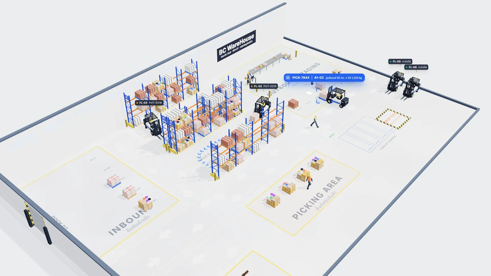

คลังจำลองเป็นคลังวัสดุก่อสร้างหนึ่งหลัง ประกอบด้วย

- **ท่าขนถ่าย 2 ท่า** ที่ผนังฝั่งตะวันตก: **Dock 01 = ขาออก** (มีรถบรรทุกจอด) และ **Dock 02 = ขาเข้า**
- **ชั้นวางพาเลทแบบ Selective 4 แถว** (A1, A2, B1, B2) ทุกช่องมีรหัสตำแหน่ง เช่น `A2-03`
- **รถยกโฟร์คลิฟต์ 6 คัน** (FL-01 ถึง FL-06) ทำงาน 4 คัน และจอดชาร์จแบตเตอรี่ 2 คัน
- **สายพานลำเลียงแบบลูกกลิ้ง** และจุดแพ็กสินค้า
- **พนักงานในคลัง** ที่เดิน เอื้อม และก้มตัวได้ (รถยกตรวจจับพนักงานได้)
- **โซนบนพื้นคลัง:** โซนรับสินค้า (INBOUND), โซนหยิบสินค้า (PICKING AREA), โซนเตรียมส่ง (OUTBOUND STAGING), โซนสินค้ายาว (LONG GOODS) และที่จอดรถยก

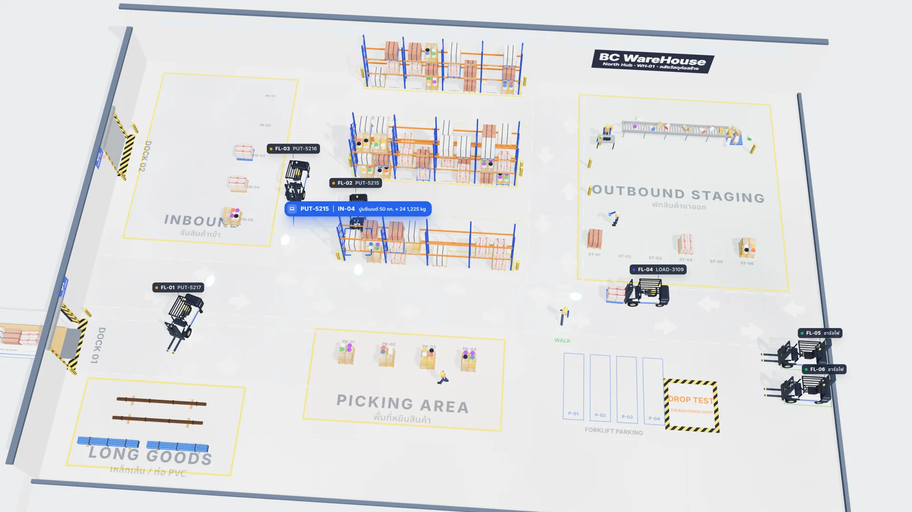

**สินค้าในคลัง** มีน้ำหนักสมจริง และใช้คำนวณฟิสิกส์จริง (ค่าจาก `index.html` ส่วนที่ 10):

| สินค้า | น้ำหนักสินค้าบนพาเลท |
|---|---|
| ปูนซีเมนต์ 50 กก. × 24 ถุง | 1,200 กก. (+ พาเลทเปล่า 25 กก. = 1,225 กก.) |
| อิฐมวลเบา AAC | 850 กก. |
| อิฐแดง (มอญ) | 850 กก. |
| Mixed SKU · สี/ฮาร์ดแวร์ | 420 กก. |
| เหล็กเส้นข้ออ้อย DB28 · 6 ม. / ท่อ PVC | มัดสินค้ายาว วางที่โซน LONG GOODS |

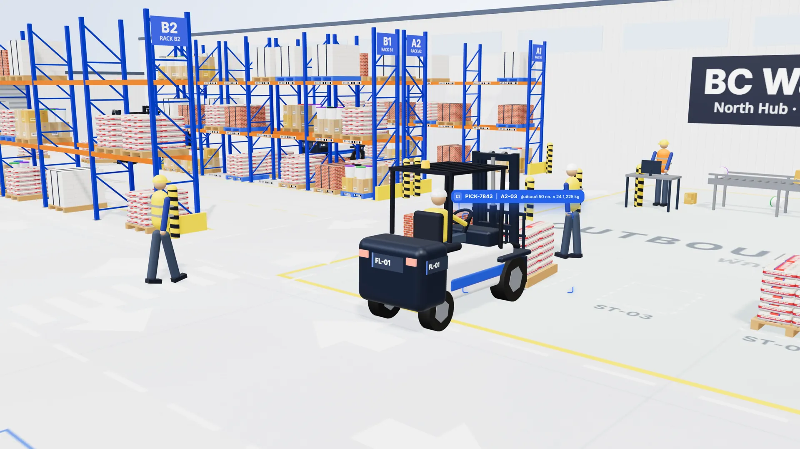

---

## 4. รถยก AI และระบบจ่ายงาน (WMS)

### 4.1 การทำงานตั้งแต่ออร์เดอร์ถึงรถยก

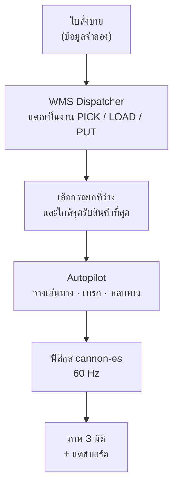

**ประเภทงาน**

| งาน | ความหมาย | ตัวอย่าง |
|---|---|---|
| `PICK` | หยิบพาเลทจากชั้นวางไปวางที่จุดเตรียมส่ง | `PICK-7843 · A2-03 → ST-02` |
| `LOAD` | ขนพาเลทจากจุดเตรียมส่งขึ้นรถบรรทุกที่ Dock 01 (ช่องบนรถ `TR-01` … `TR-05`) | `LOAD-3109 · ST-03 → TR-xx` |
| `PUT` | จัดเก็บพาเลทจากโซนรับสินค้าขึ้นชั้นวาง (ระบบเลือกช่องว่างให้) | `PUT-5214 · IN-02 → A2-01` |

**กติกาการจ่ายงาน** (จากฟังก์ชัน `assignTasks()` ใน `index.html`)

- ลำดับความสำคัญ: `LOAD` ก่อน → `PICK` ของออร์เดอร์ปัจจุบัน → `PUT` → งานอื่น
- เลือกรถยกที่ **ว่างและอยู่ใกล้จุดรับสินค้าที่สุด**
- งาน PICK เลือก **จุดเตรียมส่งที่ว่างและใกล้ที่สุด**
- วิ่งงาน PICK พร้อมกันได้ 2 คัน (กด **Expedite** เพิ่มเป็น 3 คัน)

### 4.2 รถยกขับเองอย่างไร

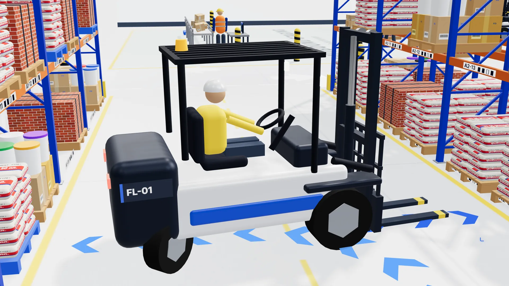

- **วางเส้นทางเอง** บนกราฟจุดนำทาง (Dijkstra/A\*) วิ่งชิดขวาของเลน แสดงเป็นลูกศรสีฟ้าบนพื้น
- **ขั้นตอนของงาน:** รอคิว (Queued) → กำลังไป (En route) → ยกสินค้า (Lifting) → ขนย้าย (Transporting) → วางสินค้า (Placing)
- **เบรกเองเมื่อมีสิ่งกีดขวาง** ด้วยเซนเซอร์แบบลำแสง (ray) ตรวจจับรถคันอื่น พนักงาน และสินค้า
- **ชะลอที่ทางม้าลาย:** จำกัดความเร็วไม่เกิน 1.5 ม./วินาที (5.4 กม./ชม.)
- **หลบทางเมื่อสวนกันในทางแคบ:** ถ้าติดกันนานเกิน 2.5 วินาที คันหนึ่งจะถอยหลบให้
- **กู้คืนอัตโนมัติ** เมื่อรถติดหรือพลิกคว่ำ

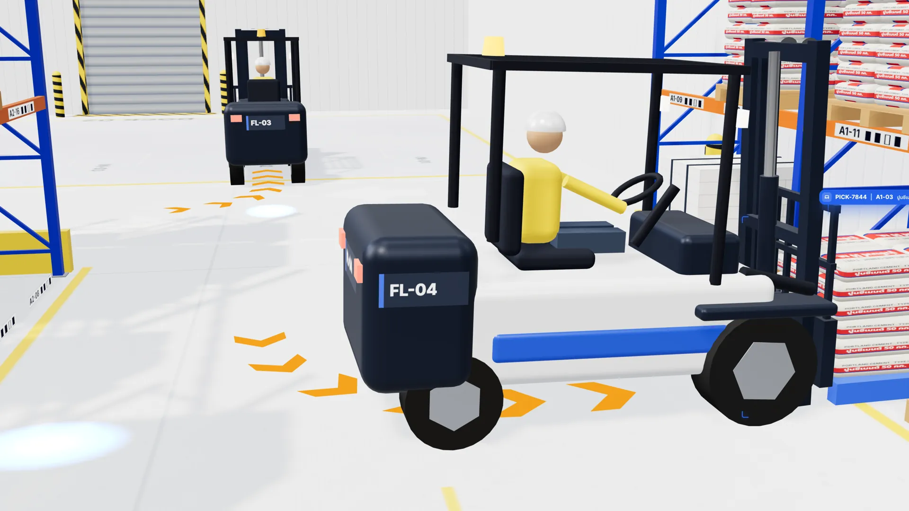

**สถานะรถยก** ที่แสดงในแผง Fleet Telemetry

| สถานะในระบบ | แสดงผล |
|---|---|
| Idle | ว่าง |
| Picking | หยิบสินค้า |
| Loading | โหลดขึ้นรถ |
| Put-away | จัดเก็บ |
| Returning | กลับจุดจอด |
| Charging | ชาร์จไฟ |
| Manual | ขับเอง |
| Tipped | พลิกคว่ำ |

### 4.3 รถบรรทุกที่ท่าขาออก

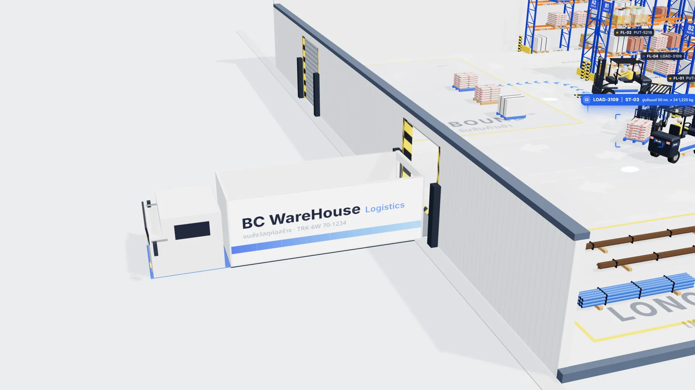

รถบรรทุก 6 ล้อ (`TRK-6W 70-1234`) จอดที่ **Dock 01** รับได้ 5 พาเลท
เมื่อโหลดครบตามออร์เดอร์ รถจะออกจากท่าและประตูม้วนปิด จากนั้นรถเปล่าจะถอยกลับเข้าท่าเพื่อรับออร์เดอร์ถัดไป พาเลทบนรถถูกพาไปด้วยแรงเสียดทานจริง ไม่ได้ผูกติดกับรถ

---

## 5. แดชบอร์ดและแผงข้อมูล

### 5.1 การ์ด KPI

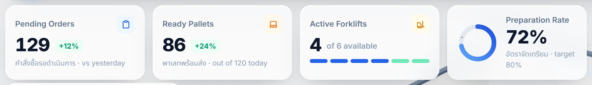

| การ์ด | ความหมาย |
|---|---|
| **Pending Orders** | คำสั่งซื้อรอดำเนินการ เทียบกับเมื่อวาน |
| **Ready Pallets** | พาเลทพร้อมส่ง จากเป้าวันนี้ |
| **Active Forklifts** | รถยกที่ทำงานอยู่ จากทั้งหมด 6 คัน (แถบน้ำเงินเข้ม = มีงาน, น้ำเงินอ่อน = ว่าง, เขียว = จอดชาร์จ) |
| **Preparation Rate** | อัตราการจัดเตรียมสินค้า เทียบเป้า 80% |

### 5.2 ใบสั่งขาย (Sales Order)

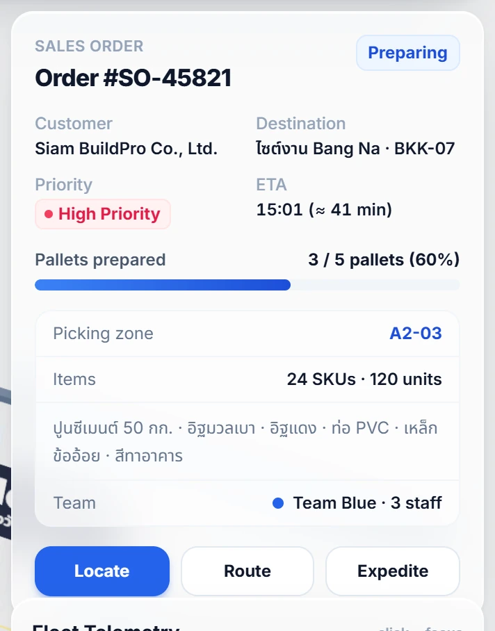

แสดงออร์เดอร์ที่กำลังเตรียม เช่น `SO-45821` ของลูกค้า Siam BuildPro Co., Ltd. ส่งไซต์งาน Bang Na · BKK-07 พร้อมความสำคัญ, เวลาถึงโดยประมาณ (ETA), พาเลทที่เตรียมแล้ว, โซนหยิบสินค้า, รายการสินค้า และทีมงาน

| ปุ่ม | การทำงาน |
|---|---|
| **Locate** | พากล้องบินไปที่พาเลทของงานที่เลือก (ถ้าไม่มี กลับมุมมองหลัก) |
| **Route** | สลับระหว่างแสดงเส้นทางของรถ **ทุกคัน** กับเฉพาะงานที่เลือก |
| **Expedite** | ตั้งออร์เดอร์เป็นงานเร่งด่วน และเพิ่มรถหยิบสินค้าพร้อมกันเป็น 3 คัน |

### 5.3 สถานะรถยก (Fleet Telemetry) และบันทึกเหตุการณ์

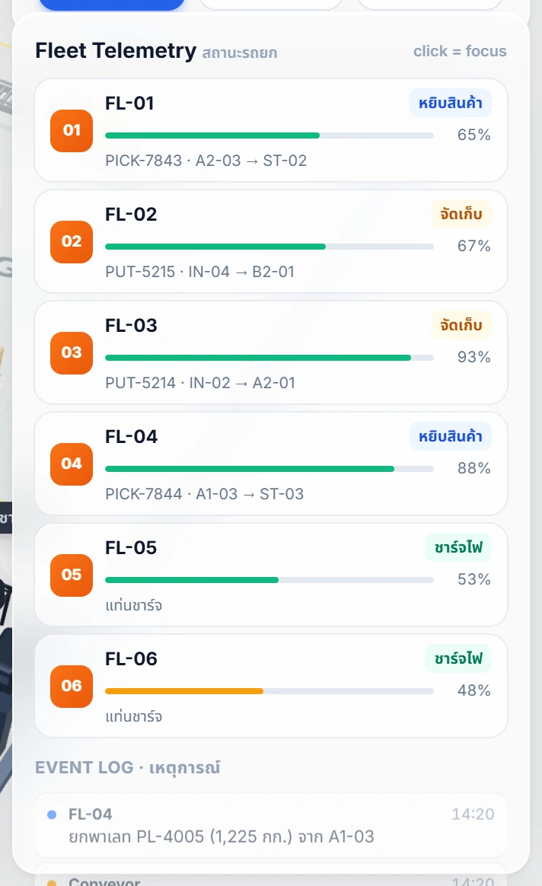

- แต่ละแถวแสดง **ชื่อรถ, สถานะ, งานที่ทำ (ต้นทาง → ปลายทาง) และระดับแบตเตอรี่**
- **คลิกแถว** เพื่อให้กล้องบินไปที่รถคันนั้น (ในโหมดขับเอง คลิกเพื่อเปลี่ยนคันที่ขับ)
- **Event Log** บันทึกเหตุการณ์พร้อมเวลา เช่น รถยกยกพาเลท, รับสินค้าเข้า, รถบรรทุกออกเดินทาง, พนักงานข้ามทางม้าลาย, รถเสียสมดุล/พลิกคว่ำ (เก็บล่าสุด 40 รายการ)

### 5.4 ขั้นตอนเตรียมส่ง งานปัจจุบัน และคิวงาน

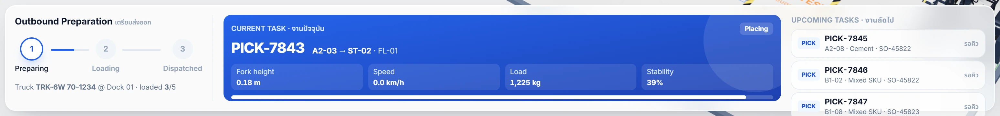

- **Outbound Preparation** มี 3 ขั้นตอน: เตรียมสินค้า (Preparing) → กำลังโหลด (Loading) → ออกจากคลัง (Dispatched) พร้อมจำนวนพาเลทที่โหลดขึ้นรถแล้ว
- **Current Task** แสดงงานที่เลือก: รหัสงาน, ต้นทาง → ปลายทาง, รถที่รับงาน, ขั้นตอน และค่าสด 4 ค่า: **ความสูงงา, ความเร็ว, น้ำหนักบรรทุก, ค่าความเสถียร**
- **Upcoming Tasks** แสดงคิวงานถัดไปที่รอรถว่าง

---

## 6. ทดลองด้วยฟิสิกส์

### 6.1 แผงควบคุมฟิสิกส์ (Physics Control)

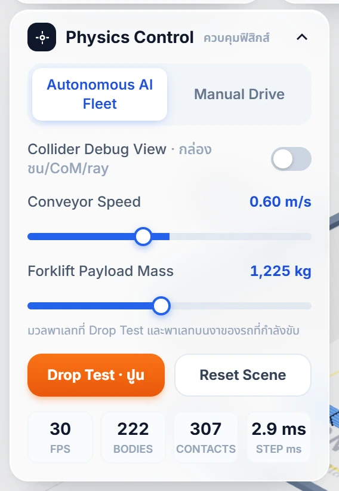

| ส่วนควบคุม | การทำงาน |
|---|---|
| **Autonomous AI Fleet / Manual Drive** | สลับระหว่างให้ AI ขับทุกคัน กับขับเองทีละคัน |
| **Collider Debug View** | แสดงกล่องชน (collider), จุดศูนย์ถ่วง (CoM) และลำแสงเซนเซอร์ |
| **Conveyor Speed** | ความเร็วสายพาน 0–1.5 ม./วินาที |
| **Forklift Payload Mass** | น้ำหนักพาเลท 100–2,500 กก. ใช้กับ Drop Test และพาเลทบนงาของรถที่กำลังขับเอง |
| **Drop Test · ปูน** | ปล่อยพาเลทปูนซีเมนต์จากความสูงประมาณ 3.2–3.8 ม. ลงจุดทดสอบ (เก็บได้สูงสุด 6 พาเลท) |
| **Reset Scene** | ล้างพาเลททดสอบและพาเลทที่หล่นผิดที่ กู้รถที่ติดหรือพลิก แล้วพากล้องกลับมุมหลัก |
| **FPS / BODIES / CONTACTS / STEP ms** | อัตราเฟรม, จำนวนวัตถุฟิสิกส์, จำนวนจุดสัมผัส, เวลาที่ใช้คำนวณฟิสิกส์ต่อรอบ |

### 6.2 Drop Test — ปล่อยพาเลทลงจากที่สูง

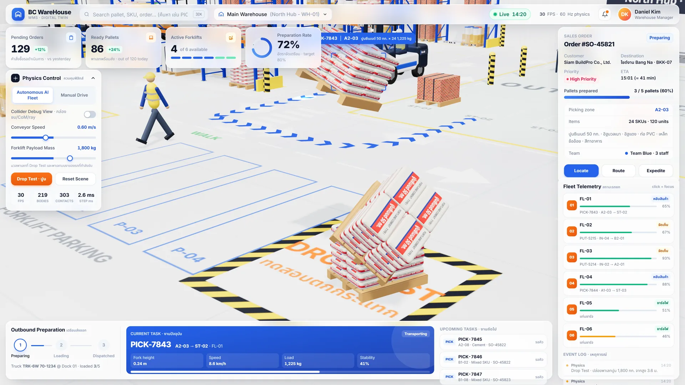

ตั้งน้ำหนักด้วยแถบ **Forklift Payload Mass** แล้วกด **Drop Test · ปูน** เพื่อดูว่าพาเลทกระแทกและล้มอย่างไร ทุกครั้งที่ปล่อย Event Log จะบันทึกน้ำหนักและความสูง

### 6.3 Manual Drive — ขับรถยกเอง

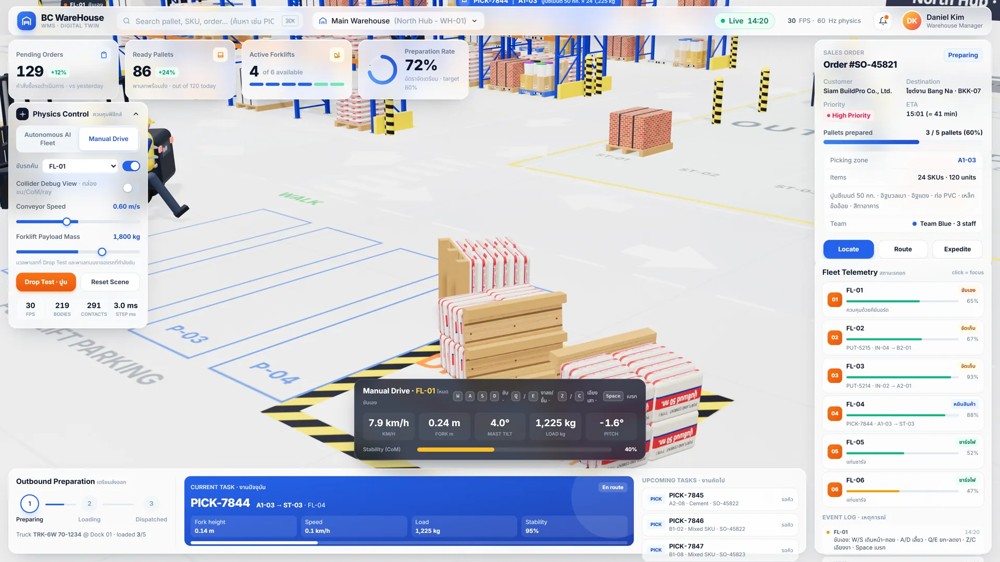

เลือก **Manual Drive** แล้วเลือกคันที่จะขับ (หรือคลิกแถวรถใน Fleet Telemetry) กล้องจะติดตามรถอัตโนมัติ ปิดได้ด้วยสวิตช์ข้างรายชื่อรถ
ใช้ฝึกพนักงานขับรถยกก่อนลงพื้นที่จริงได้ เพราะรถมีน้ำหนัก แรงเฉื่อย และพลิกคว่ำได้จริง พาเลทบนงาค้างอยู่ด้วยแรงเสียดทานเท่านั้น ถ้าเลี้ยวแรงหรือเบรกกะทันหัน สินค้าหล่นได้

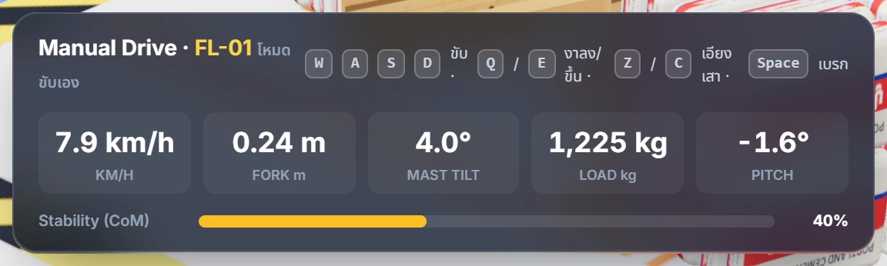

HUD แสดง **ความเร็ว (km/h), ความสูงงา (m), มุมเอียงเสา, น้ำหนักบรรทุก (kg), มุมก้มเงย (pitch)** และแถบ **ความเสถียร (Stability)** ที่คำนวณจากจุดศูนย์ถ่วง

### 6.4 Collider Debug View — ดูโลกฟิสิกส์

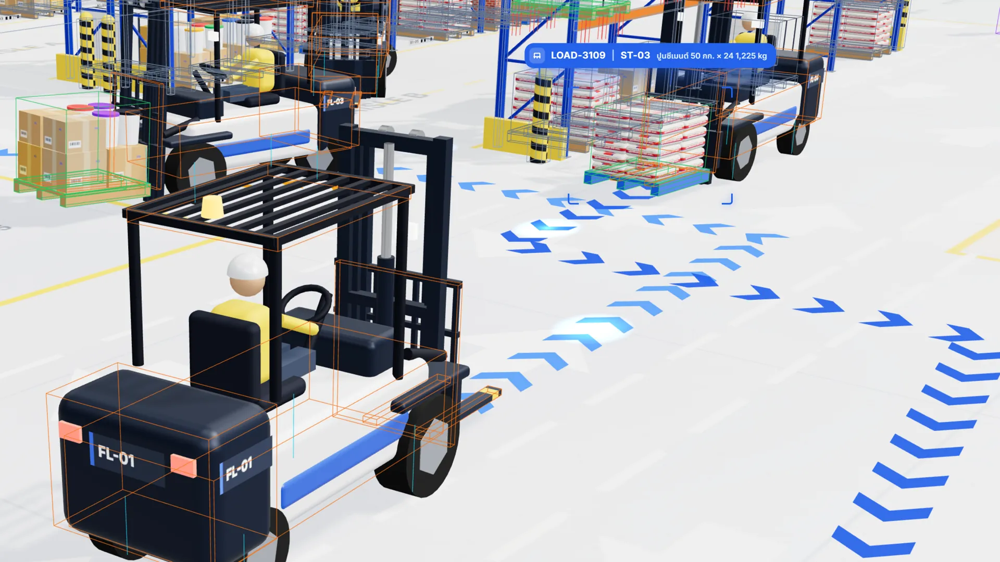

เปิดสวิตช์ **Collider Debug View** เพื่อดูกล่องชนของรถยก พาเลท และสินค้า จุดศูนย์ถ่วง และลำแสงเซนเซอร์ เหมาะสำหรับอธิบายว่าระบบคำนวณจริงทุกเฟรม

---

## 7. วิธีใช้งาน

### 7.1 เมาส์ (ควบคุมกล้อง)

| การกระทำ | ผล |
|---|---|
| ลากเมาส์ซ้าย | หมุนมุมมองรอบจุดกลาง |
| ลากเมาส์ขวา | เลื่อนมุมมอง (pan) |
| หมุนลูกกลิ้ง | ซูมเข้า/ออก (ระยะ 10–140 ม.) |

### 7.2 คีย์บอร์ด

| ปุ่ม | ผล |
|---|---|
| <kbd>/</kbd> | ไปที่ช่องค้นหา |
| <kbd>Enter</kbd> (ในช่องค้นหา) | ค้นหาแล้วพากล้องไปที่ผลลัพธ์ |
| <kbd>W</kbd> / <kbd>↑</kbd> | เดินหน้า *(โหมดขับเอง)* |
| <kbd>S</kbd> / <kbd>↓</kbd> | ถอยหลัง *(โหมดขับเอง)* |
| <kbd>A</kbd> / <kbd>←</kbd>, <kbd>D</kbd> / <kbd>→</kbd> | เลี้ยวซ้าย / ขวา *(โหมดขับเอง)* |
| <kbd>Q</kbd> / <kbd>E</kbd> | ยกงาขึ้น / ลดงาลง (สูงสุด 3.95 ม.) *(โหมดขับเอง)* |
| <kbd>Z</kbd> / <kbd>C</kbd> | เอียงเสา *(โหมดขับเอง)* |
| <kbd>Space</kbd> | เบรก *(โหมดขับเอง)* |

### 7.3 ค้นหา

พิมพ์ในช่องค้นหาด้านบนแล้วกด <kbd>Enter</kbd> กล้องจะบินไปที่สิ่งนั้น และบันทึกผลใน Event Log

| ค้นหาด้วย | ตัวอย่าง |
|---|---|
| รหัสงาน | `PICK-7843`, `PUT-5214`, `LOAD-3109` |
| ตำแหน่งชั้นวาง/จุดพัก | `A2-03`, `ST-02`, `IN-02` |
| รถยก | `FL-02` หรือพิมพ์เลข `2` |
| ออร์เดอร์ | `SO-45821` หรือ `45821` |

### 7.4 ตัวอย่างการใช้งาน (สาธิตลูกค้า 5 นาที)

1. เปิด <https://test01.bcsmethai.com> รอโหลดฉากฟิสิกส์ (หน้าจอ “กำลังเตรียมโลกฟิสิกส์ 3 มิติ…”)
2. ชี้ให้ดูแผง **Sales Order** → ออร์เดอร์ `SO-45821` เตรียมแล้ว 3/5 พาเลท
3. กด **Locate** → กล้องบินไปที่พาเลทของงาน `PICK-7843` ที่รถ FL-01 กำลังขน
4. ดู **Current Task** → ความสูงงา ความเร็ว น้ำหนัก และความเสถียรเปลี่ยนตามจริง
5. กด **Route** → เห็นเส้นทางรถทุกคันพร้อมกัน
6. ตั้งน้ำหนัก 1,800 กก. แล้วกด **Drop Test · ปูน** 2–3 ครั้ง → ดูพาเลทล้ม แล้วกด **Reset Scene**
7. สลับเป็น **Manual Drive** → ขับ FL-01 ด้วย <kbd>W</kbd><kbd>A</kbd><kbd>S</kbd><kbd>D</kbd> ยกงาด้วย <kbd>Q</kbd>
8. ปิดท้ายด้วยแนวทางเชื่อม ERP ในหัวข้อ 9

---

## 8. ติดตั้งและรันบนเครื่อง

### 8.1 สิ่งที่ต้องมี (Dependency)

แอปทั้งหมดอยู่ใน **`index.html` ไฟล์เดียว** ไม่ต้อง build ไม่มี backend แต่ต้องต่ออินเทอร์เน็ตเพื่อโหลดไลบรารีจาก CDN

| ไลบรารี | เวอร์ชัน | ใช้ทำ | แหล่ง |
|---|---|---|---|
| [three.js](https://threejs.org) | 0.160.0 | วาดภาพ 3 มิติ (WebGL) + OrbitControls | unpkg (importmap) |
| [cannon-es](https://github.com/pmndrs/cannon-es) | 0.20.0 | ฟิสิกส์ rigid-body, RaycastVehicle | unpkg (importmap) |
| [Tailwind CSS](https://tailwindcss.com) | Play CDN | จัดหน้าแผงข้อมูล | cdn.tailwindcss.com |
| Google Fonts | – | ฟอนต์ Inter + Noto Sans Thai | fonts.googleapis.com |

เบราว์เซอร์: ทดสอบกับ **Google Chrome** บนจอ 1920×1080 ต้องรองรับ WebGL และ ES Modules

### 8.2 รันบนเครื่อง

ไฟล์ใช้ ES Modules จึงควรเปิดผ่านเว็บเซิร์ฟเวอร์ (ไม่เปิดด้วยการดับเบิลคลิกไฟล์) วิธีที่ง่ายที่สุดคือใช้ Python:

```bash
git clone https://github.com/jaturapornchai/bcwarehousedemo1.git
cd bcwarehousedemo1
python -m http.server 8765 --bind 127.0.0.1
```

จากนั้นเปิด <http://localhost:8765/>

### 8.3 นำขึ้นเว็บ (Deploy)

เป็นไฟล์ static ไฟล์เดียว วางบนเว็บเซิร์ฟเวอร์ใดก็ได้ (Caddy, Nginx, GitHub Pages ฯลฯ) ไม่มีค่าตั้งค่า (config) หรือรหัสลับที่ต้องกำหนด

### 8.4 ค่าที่ปรับได้ในโค้ด (Config)

ค่าการจำลองเป็นค่าคงที่ใน `index.html` เช่น

| ค่า | ตำแหน่งในโค้ด | ความหมาย |
|---|---|---|
| `DT = 1 / 60` | ส่วนที่ 2 PHYSICS WORLD | ความถี่คำนวณฟิสิกส์ 60 Hz |
| `CARGO_TYPES` (`cement`, `aac`, `brick`, `mixed`) | ส่วนที่ 10 | ชนิดสินค้าและน้ำหนัก |
| `FL.maxLift = 3.95` | ส่วนที่ 12 | ความสูงงาสูงสุด (ม.) |
| `DISPATCH.maxPicks = 2` | ส่วนที่ 14 | จำนวนรถที่วิ่งงาน PICK พร้อมกัน |
| `CUSTOMERS` | ส่วนที่ 14 | รายชื่อลูกค้าจำลอง |
| `KPI` | ส่วนที่ 19 | ค่าเริ่มต้นของการ์ด KPI |

---

## 9. แนวทางสู่ระบบจริง (แนวคิด — ยังไม่มีในเดโม)

> [!NOTE]
> หัวข้อนี้เป็น **แนวคิด** สำหรับพัฒนาระบบจริง เดโมปัจจุบันยังไม่เชื่อมต่อระบบภายนอกใดๆ

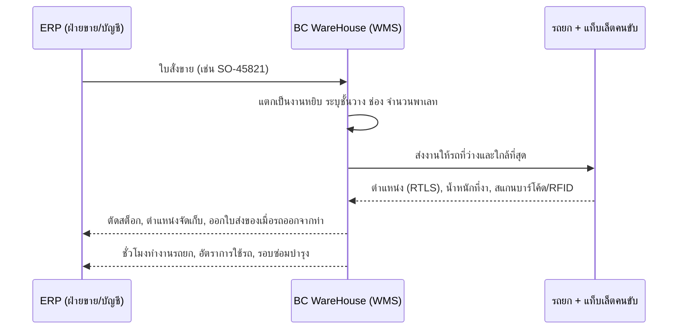

**แนวทาง 6 ข้อจากเดโมสู่ระบบจริง**

1. แท็กระบุตำแหน่งในอาคาร (RTLS) บนรถยกทุกคัน
2. เซนเซอร์ชั่งน้ำหนักที่งา
3. สแกนบาร์โค้ด / RFID ที่พาเลทและชั้นวาง
4. แอปบนแท็บเล็ตสำหรับคนขับ
5. แจ้งเตือนหัวหน้างานผ่าน LINE
6. เชื่อม ERP สองทางผ่าน API

**ตัวอย่างประโยชน์เมื่อเชื่อม ERP**

- **ขาออก:** ฝ่ายขายเปิดใบสั่งขายแล้ว คลังได้งานหยิบทันที ไม่ต้องรอใบงานกระดาษ และเมื่อรถออกจากท่า ERP ออกใบส่งของและตัดสต็อกได้อัตโนมัติ
- **ขาเข้า:** ยอดสต็อกเพิ่มทันทีที่สินค้าเข้าที่ พร้อมตำแหน่งจัดเก็บ ไม่ต้องรอนับมือตอนสิ้นวัน
- **ติดตามรถยก:** ชั่วโมงทำงาน อัตราการใช้รถ และรอบซ่อมบำรุง ส่งกลับเข้า ERP
- **ความปลอดภัย:** กำหนดความเร็วตามโซน และแจ้งเตือนเมื่อรถวิ่งเร็วเกิน

---

## 10. โครงสร้างโค้ด

```text
bcwarehousedemo1/
├── index.html        # แอปทั้งหมด (HTML + CSS + JavaScript module) ไฟล์เดียว
├── README.md         # เอกสารนี้
└── docs/images/      # ภาพประกอบ README (ถ่ายจากแอปจริงด้วย Playwright)
```

โค้ดใน `index.html` แบ่งเป็นส่วนที่มีหัวข้อกำกับ ค้นหาได้ด้วยเลขส่วน เช่น `13. NAVIGATION`

| ส่วน | หัวข้อ | หน้าที่ |
|---|---|---|
| 0–1 | Utilities, Renderer / Scene / Camera / Lights | ค่าคงที่ ตัวช่วย กล้อง แสง เงา |
| 2 | Physics World | โลกฟิสิกส์ cannon-es 60 Hz, วัสดุและแรงเสียดทาน |
| 3–4 | Instanced Visual System, Procedural Canvas Textures | วาดชิ้นส่วนซ้ำแบบ instancing และสร้างพื้นผิวด้วยโค้ด (ไม่มีไฟล์ภาพ) |
| 5–6 | Layout, Floor + Building Shell | ผังคลัง พื้นทาสีโซน ผนัง ประตูม้วน ท่าขนถ่าย |
| 7–8 | Six-Wheel Box Truck, Safety Bollards | รถบรรทุก 6 ล้อ และเสากันชน |
| 9 | Selective Pallet Racks + Slot Registry | ชั้นวาง A1/A2/B1/B2 และทะเบียนช่องจัดเก็บ |
| 10 | Construction Material Cargo Factory | สร้างพาเลทและมัดสินค้าที่มีน้ำหนักจริง |
| 11 | Roller Conveyor | สายพานลูกกลิ้ง (ขับสินค้าด้วยแรงเสียดทานผิว) |
| 12 | Counterbalance Forklift | รถยก RaycastVehicle + ชุดงาไฮดรอลิก |
| 13 | Navigation | กราฟจุดนำทาง, Dijkstra/A\*, เลนชิดขวา |
| 14 | WMS Dispatcher | ออร์เดอร์ งาน PICK/LOAD/PUT การจองช่อง |
| 15 | Forklift Autopilot | ขั้นตอนเข้า-ยก-ถอย-วาง, เบรกด้วยเซนเซอร์, หลบทาง, กู้คืน |
| 16 | Dock 01 Truck Cycle | รถออกเมื่อครบออร์เดอร์ แล้วกลับมาเปล่า |
| 17 | Workers | พนักงานเดิน เอื้อม ก้ม พร้อมตัวตรวจจับ |
| 18 | Initial State | สต็อก ออร์เดอร์ รถยก ที่จอด ที่ชาร์จตอนเริ่ม |
| 19 | KPI Model + Event Log | ตัวเลข KPI และบันทึกเหตุการณ์ |
| 20 | Route Ribbon + Physics Debug | ลูกศรเส้นทาง และมุมมอง Debug |
| 21–22 | Camera, Manual Drive | กล้องบิน/ติดตาม และโหมดขับเอง |
| 23 | Drop Test + Reset | ทดสอบปล่อยพาเลท และรีเซ็ตฉาก |
| 24–25 | UI Binding, Main Loop + Boot | ผูกข้อมูลกับแผง UI และลูปหลัก |

---

## 11. ข้อจำกัดและปัญหาที่ทราบ

**ข้อจำกัด**

- ข้อมูลทั้งหมดเป็น **ข้อมูลจำลอง** ไม่มีฐานข้อมูล ไม่มี API และไม่เชื่อมต่อ ERP จริง
- **ไม่บันทึกสถานะ:** รีเฟรชหน้าเว็บแล้วคลังจะเริ่มใหม่ทุกครั้ง
- ต้องต่ออินเทอร์เน็ตเพื่อโหลด three.js, cannon-es, Tailwind และฟอนต์จาก CDN
- ออกแบบสำหรับ **จอเดสก์ท็อป** (ทดสอบที่ 1920×1080) ยังไม่ได้ปรับสำหรับมือถือ
- ฟิสิกส์และภาพ 3 มิติใช้ทรัพยากรเครื่อง เครื่องที่ไม่มีการ์ดจอหรือรุ่นเก่าอาจได้ FPS ต่ำ

**ปัญหาที่ทราบ**

- งานจัดเก็บ (PUT) บางครั้งใช้เวลานาน เพราะรถ 2 คันอาจหลบทางให้กันไปมาในเลนแคบฝั่งตะวันตก
- ป้ายบน HUD โหมดขับเองเขียน “Q / E งาลง/ขึ้น” แต่ในโค้ด **Q = ยกงาขึ้น, E = ลดงาลง** (ตารางในหัวข้อ 7.2 ถูกต้องตามโค้ด)
- ช่องค้นหาแสดงป้าย `⌘K` แต่ปุ่มลัดที่ใช้งานได้จริงคือ <kbd>/</kbd>

---

<p align="center">
  <b>BC WareHouse</b> · เดโมต้นแบบ · ข้อมูลจำลอง<br/>
  พัฒนาโดย <b>บริษัท บ้านเชียงซอฟท์ จำกัด</b> · <a href="https://test01.bcsmethai.com">test01.bcsmethai.com</a>
</p>
